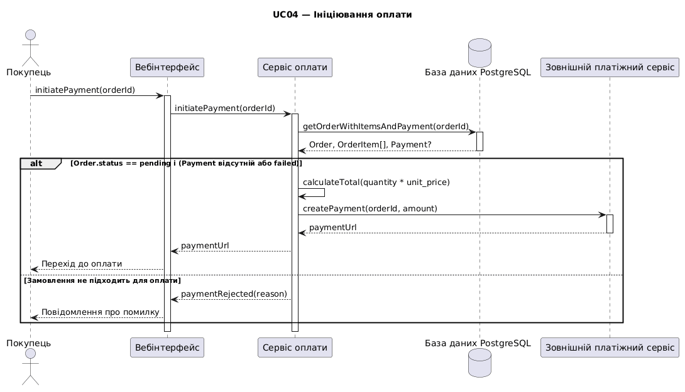
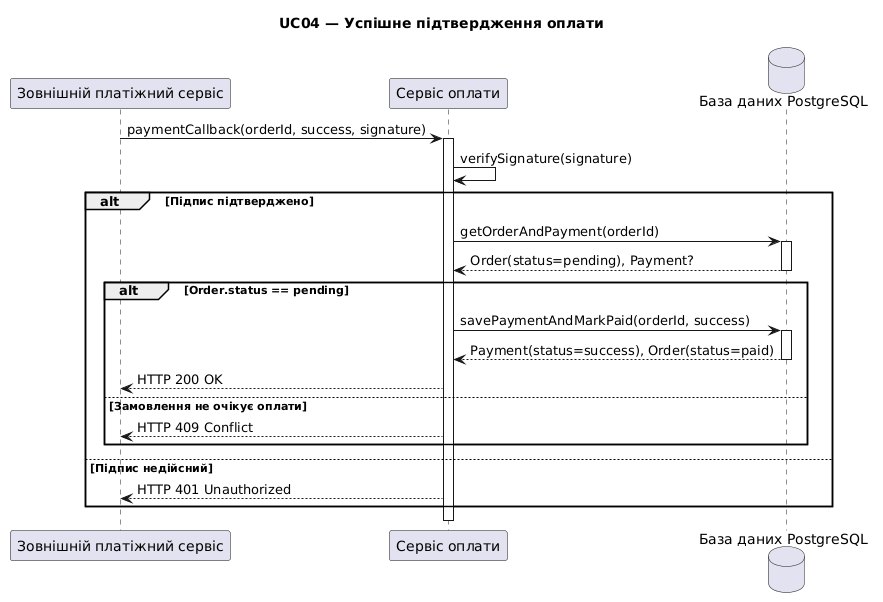
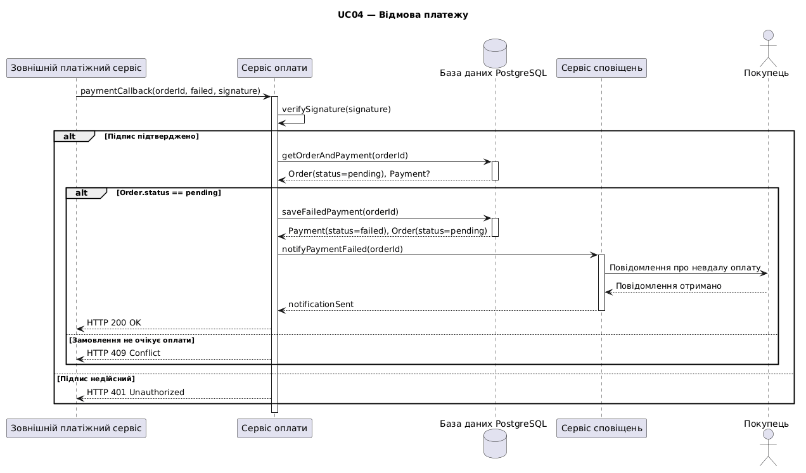
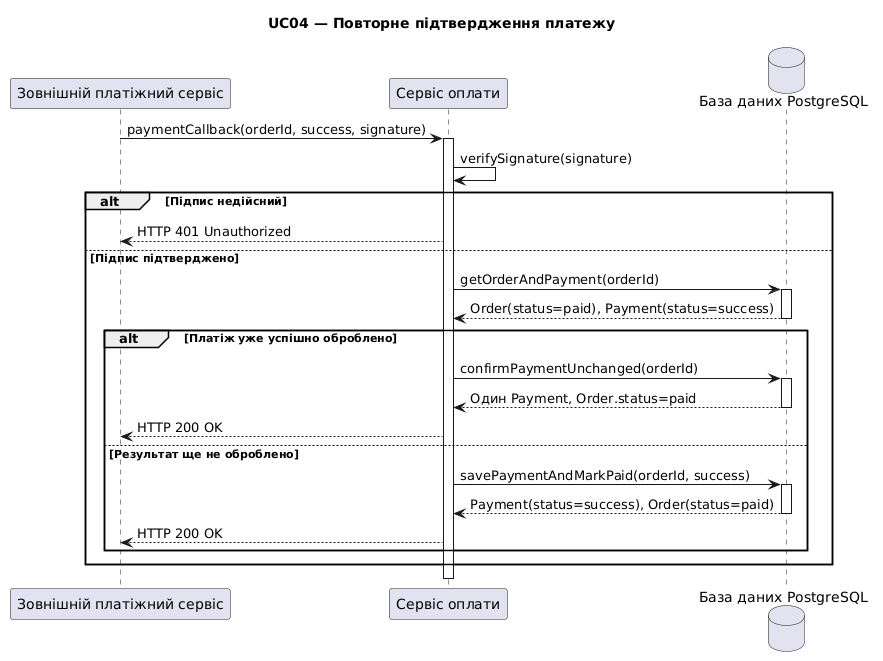
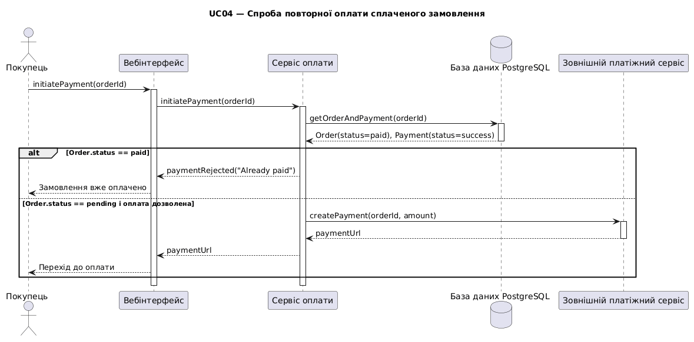

# Лабораторна робота №3 — Sequence-діаграми

## Тема
Розробка діаграм послідовності для онлайн-магазину.

## Обраний Use Case
**UC04 — Оплатити замовлення.**

Мета роботи — змоделювати взаємодію покупця, вебінтерфейсу, сервісу оплати, бази даних та зовнішнього платіжного сервісу для п'яти сценаріїв оплати.

## Sequence-діаграми

### 1. Ініціювання оплати
[Код PlantUML](sequence-01.puml)

### 2. Успішне підтвердження оплати
[Код PlantUML](sequence-02.puml)

### 3. Відмова платежу
[Код PlantUML](sequence-03.puml)

### 4. Повторне підтвердження платежу
[Код PlantUML](sequence-04.puml)

### 5. Спроба повторної оплати сплаченого замовлення
[Код PlantUML](sequence-05.puml)

## Документація

- [Специфікація сценаріїв](spec.md)

## Використані технології

- PlantUML
- GitHub
- PostgreSQL (модель бази даних)

## Результат

Створено п'ять діаграм послідовності для UC04 «Оплатити замовлення». Діаграми відображають обмін повідомленнями, відповіді компонентів, альтернативні гілки та активації учасників.
